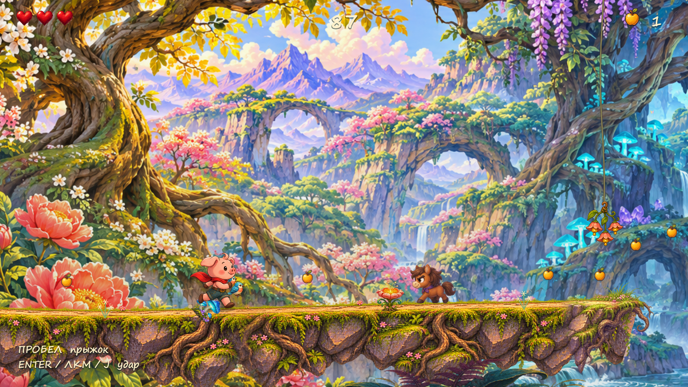
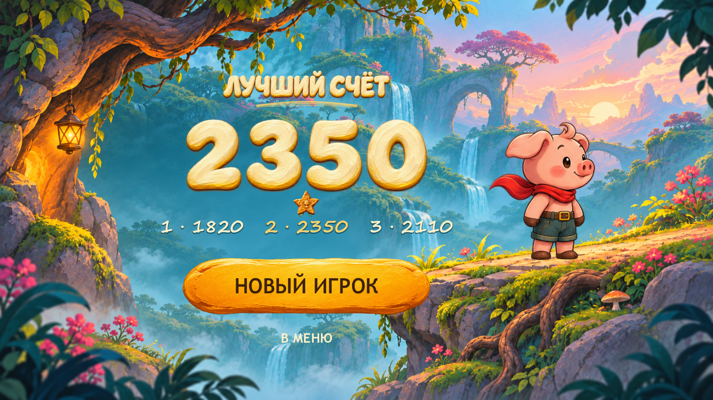

# ХрюША2026

Рисованный 2D-раннер для живого квеста. Хрюша сама бежит вперёд, собирает яблоки, прыгает, бьёт лошадей и других врагов, цепляется за тросы и меняет гравитацию.

**[Скачать игру для Windows — ZIP](https://github.com/storkych/SHA2026-XruSHA/releases/latest/download/KhryuSHA2026-Windows.zip)** · [Скачать одним EXE](https://github.com/storkych/SHA2026-XruSHA/releases/latest/download/KhryuSHA2026-Windows.exe) · [Последний релиз](https://github.com/storkych/SHA2026-XruSHA/releases/latest)

Распакуй ZIP и запусти `KhryuSHA2026.exe`. Установка, интернет и редактор Godot для игры не нужны. Windows x64. Репозиторий приватный: для скачивания нужен вход в GitHub с доступом к нему.



## Правила

Три попытки; в зачёт идёт лучший результат. Счёт — пройденные метры плюс 10 за каждое яблоко. Трасса всегда одинаковая: 4800 метров, шесть смен гравитации, четыре троса, движущиеся и разрушающиеся платформы. Скорость постепенно растёт до предела.

В мире 64 небольших события: птицы взлетают, улитки прячутся, цветы звенят, грибы выпускают споры, светлячки разлетаются, кристаллы отзываются на удары, лужицы брызгают. Плодовый кокон даёт три яблока за удар, один раз за попытку.

## Управление

| Действие | Клавиши | Геймпад |
| --- | --- | --- |
| Прыжок | Пробел / W / ↑ / ПКМ | A |
| Высокий прыжок | Удерживать прыжок | Удерживать A |
| Удар | Enter / ЛКМ / J / X | X / B / RT |
| Пауза | Esc / P | Start |
| Меню | Мышь / стрелки / Enter | Стик / крестовина / A |
| Звук | M | Кнопка в меню |
| Полный экран | F11 / F | Кнопка в меню |

На лошадь или слизня можно прыгнуть сверху. Жук выдерживает два удара. Трос цепляется в прыжке; ещё один прыжок отпускает его. Подробная [инструкция](docs/КАК%20ИГРАТЬ.txt) входит в ZIP.



## Исходники и проверка

Godot 4.7.2, главный проект `project.godot`, сцена `runner/main.tscn`. Игровой код — `runner/`, музыка и звуки — `scripts/sound.gd`, рисунки — `assets/runner/`, визуальные рефы — `references/`.

Открой проект в Godot и нажми F5. Для сборки нужен профиль `Windows Desktop` и Windows export templates; в локальном `export_presets.cfg` пути к шаблонам указывают на `.tools/windows-templates/`. Сам движок и шаблоны в Git не хранятся.

Автоматические проверки запускаются так (укажи путь к своему Godot):

```powershell
$godot = '.tools/godot/Godot_v4.7.2-stable_win64_console.exe'
& $godot --headless --path . --script res://runner/tests.gd -- --test-runner
& $godot --headless --path . --script res://qa/world_life_v8_tests.gd -- --test-runner
& $godot --headless --path . --script res://qa/polish_v7_tests.gd -- --test-runner
& $godot --headless --path . --script res://qa/combat_v5_tests.gd -- --test-runner
& $godot --headless --path . --script res://qa/feel_tests.gd -- --test-runner
& $godot --headless --path . --script res://qa/worlds_v6_tests.gd -- --test-runner
```

Полный автоматический заезд проходит 4800 м через все ворота и тросы. Эти проверки не заменяют ручную оценку управления; физический геймпад отдельно не проверялся.

## Публикация следующей сборки

Готовые EXE и ZIP хранятся в **Releases**, а не в истории исходников. Имена файлов стабильны, поэтому ссылки «Скачать игру» выше всегда ведут на свежую версию.

1. Собери и проверь EXE, обнови `RELEASE_NOTES.md` и инструкцию.
2. Закоммить и отправь исходники в `main`.
3. Запусти скрипт с новым тегом и путём к сборке:

```powershell
./scripts/publish-release.ps1 -Tag v1.8.0 -GameExe build/windows/KhryuSHA2026-v9.exe
```

Нужен установленный и авторизованный GitHub CLI (`gh`). Скрипт создаёт ZIP с инструкцией и сведениями о движке, считает SHA-256, загружает файлы в черновик, проверяет размеры и серверные контрольные суммы, затем публикует релиз как последний. Существующие релизы не перезаписываются. Для локальной упаковки без публикации добавь `-PackageOnly`.

Игра использует [Godot Engine](https://godotengine.org/license/). Сведения о движке и его компонентах находятся в [licenses](licenses/) и входят в ZIP.
